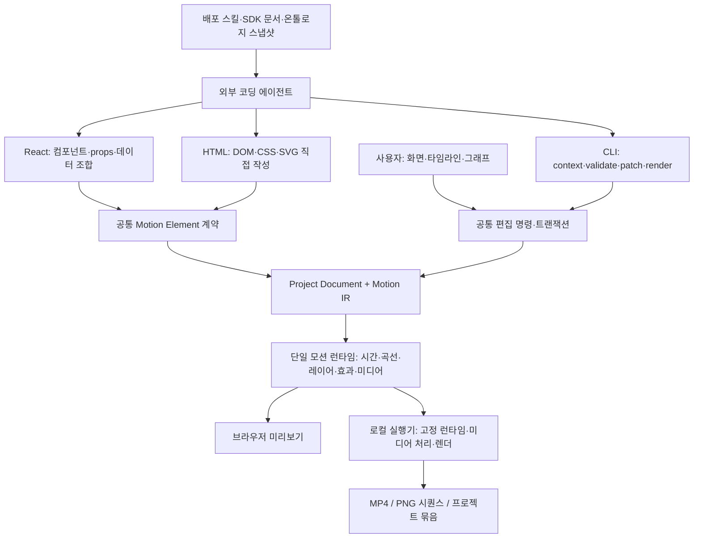

# MotiFrame — 제품·기술·개발 계획

상태: 구현 전 계획. 제품명은 사용자 확정 **모티프레임(MotiFrame)**이며 구현·설치·배포는 시작하지 않았다.

사용자 확정 요구: **React 중심 Remotion과 HTML 중심 HyperFrames의 장점을 하나로 통합하고 모션에 최적화하는 것이 가장 큰 목적이다.** OS를 가리지 않고 AI와 타임라인을 함께 사용해 짧은 모션그래픽과 모션 중심 영상을 제작한다. After Effects의 편집 방식, motion-rhythm 스킬, 기존 모션그래픽 조사·온톨로지를 함께 참고한다.

**추가 확정:** AI 작업은 프로그램 내부가 아니라 외부 코딩 에이전트가 수행한다. 프로그램은 에이전트에 제공할 SDK·CLI·스킬과 사람이 사용하는 타임라인을 제공한다. 모델 공급자 연결·채팅·인증은 제품 내부 기능으로 만들지 않는다.

구체적 실행 순서: [[30-context/projects/motion-score-studio/implementation-plan]] — 공통 계약 8개, 5단계·25작업.

아래 첫 버전 범위·엔진·화면 구성은 이 요구를 구체화한 설계 제안이다. 사용자가 모든 세부를 확정한 것으로 취급하지 않는다.

## 1. 제품의 중심

**React의 조합·매개변수·데이터 기반 재사용성과 HTML/CSS/SVG의 직접적인 표현·수정 방식을 하나의 모션 코어로 통합한다.** React로 작성한 요소와 HTML로 작성한 요소가 한 장면에 함께 놓이고 같은 시계·키프레임·곡선·효과·타임라인으로 움직인다. 사용자가 프로젝트마다 엔진을 선택하거나 두 개의 렌더 시스템을 따로 관리할 필요가 없는 제품이 목표다.

이 공통 코어 위에 프레이즈와 주행동을 설계하는 **시간 악보(Motion Score)**를 둔다. 속도·텐션·리듬을 각각 설계하고, 외부 코딩 에이전트와 사람이 같은 편집 명령으로 타입·영상·도형·사운드를 수정한다. 시간 악보는 통합 엔진의 모션 연출 계층이다.

첫 사용자는 마스터처럼 직접 연출을 판단하면서 AI에게 초안과 반복 수정을 맡기는 제작자다. 잠정 목표 작업은 5–60초 타이포, 브랜드·제품 소개, 음악을 곁들인 영상과 그래픽의 편집이다. 프로젝트 저장 형식에는 60초의 하드 제한을 두지 않되, 첫 성능 검증은 이 범위로 제한한다.

대표 작업 흐름:

1. 외부 코딩 에이전트에게 문구·자산·화면비·길이와 제작 스킬을 제공한다.
2. 에이전트가 모션리듬·온톨로지 근거를 읽고 SDK로 React/HTML 요소와 프레이즈를 작성한다.
3. CLI로 검사·캡처·출력하고, 사용자는 같은 프로젝트를 화면과 타임라인에서 직접 수정한다.
4. 사용자는 선택 구간·고정 조건을 저장하고 외부 에이전트에게 부분 수정을 지시한다.
5. 에이전트는 CLI로 최신 revision·잠금·수동 변경을 읽고 검증된 transaction을 제출한다. 변경은 타임라인과 동일한 편집 이력에 반영된다.
6. 핵심 프레이즈와 전체 재생을 비교한 뒤 영상으로 출력한다.

AI 없이도 프로젝트 열기, 수동 편집, 저장, 로컬 렌더가 가능해야 한다.

## 2. 세 도구에서 가져올 설계

| 참고 | 확인한 장점 | 이 프로그램의 적용 |
|---|---|---|
| Remotion | 프레임 기반 컴포지션, React Player에 프로젝트 상태 전달, 다중 트랙 타임라인 설계 | React 컴포넌트 작성, props·데이터 기반 반복·조합, 명시적인 시간 평가와 재사용 |
| HyperFrames | HTML·CSS와 seek 가능한 애니메이션, Chromium·FFmpeg 렌더, Studio와 에이전트 워크플로우 | HTML/CSS/SVG 직접 작성, DOM의 자유로운 표현, 에이전트 친화적인 수정, 프레임 캡처·인코딩 |
| After Effects | 레이어·키프레임, 값/속도 그래프, 텍스트 Animator·Selector, 중첩 컴포지션의 조절 속성 | 수동 정밀 편집, 글자/어절 범위 선택, 프레이즈 재사용·인스턴스별 조절 |

**React와 HTML의 통합은 첫 버전의 필수 조건이다.** 둘은 작성 방식이며, 결과는 공통 Motion Element 계약과 하나의 런타임으로 묶는다. 기존 Remotion/HyperFrames 프로젝트 파일의 무손실 가져오기와 AE 교환은 별도 호환성 과제다. 통합을 위해 두 제품 전체를 내부에서 동시에 실행할 필요는 없다.

참고 근거: [Remotion Player](https://www.remotion.dev/docs/player), [타임라인 설계](https://www.remotion.dev/docs/building-a-timeline), [HyperFrames](https://github.com/heygen-com/hyperframes), [HyperFrames GSAP 계약](https://hyperframes.app/docs/3-guides/3-gsap-animation), [AE 속도 그래프](https://helpx.adobe.com/after-effects/desktop/animate-in-after-effects/speed-between-keyframes/speed.html), [AE 텍스트 애니메이션](https://helpx.adobe.com/after-effects/desktop/animating-text/text-animation/animating-text.html), [AE Essential Properties](https://helpx.adobe.com/after-effects/desktop/motion-graphics/essential-properties/essential-properties.html). 2026-10-12 확인.

## 3. Motion Rhythm을 제품 기능으로 바꾸기

| 스킬의 원칙 | 편집 기능 | 검수와 제한 |
|---|---|---|
| 속도는 화면상의 변화율 | 이동 경로, 값·속도 곡선, 가속/제동 구간 표시 | 컷 수·FPS·BPM을 속도 점수로 사용하지 않음 |
| 텐션은 미해결 기대 | 준비·가림·압축·지연·해소 마커와 연결 | 자동 ‘텐션 87점’ 대신 무엇을 기다리는지 작성하고 재생 비교 |
| 리듬은 간격·강약·묶음·쉼 | 프레이즈 트랙, onset·도착·응답 마커, accent/rest 편집 | 모든 박자에 컷이나 효과를 자동 배치하지 않음 |
| 주행동과 보조 반응 분리 | 주체, 타입, 카메라, 배경의 타이밍 역할 | 작은 자막 변화로 주체의 정체를 덮지 않음 |
| 전환은 동작의 인계 | 앞뒤 사건을 잇는 대상·방향·형태·시선 앵커 | match cut, 연속 morph, 단순 교체를 구별 |
| 읽기/변형/질감의 역할 | 동일 텍스트에도 구간별 역할과 읽기 창 지정 | 의도한 뒤집힘·크롭을 보존하며 필수 문구의 읽기 확인 |
| expressive 기본값 | 짧은 묶음과 긴 음가, 층별 시차, 부분 해소·회수 | 차분한 brief를 우선하며 모든 단어에 슬램을 강제하지 않음 |
| 의도와 결과의 대조 | 축별 ‘유지/수정/미검증’, 비교 버전, 해당 구간 재생 | 기술 검사와 실제 체감 판단을 분리 |

2D 타이포의 상위 기준은 기존 사용자 선호인 Apple 「Don't Blink」다. 가져오는 것은 문장 흐름·강세·의미 운동이며 색·폰트·영문 노출시간을 고정하지 않는다. 한글은 어절·음절·grapheme을 보존하고 의도한 자모 분해는 별도 기능으로 둔다.

스킬의 0.7초 저변화 경고와 타이밍 예시는 자동 실패 기준이나 보편 최적값으로 만들지 않는다. 역할이 있는 정지·종결은 정상이다.

## 4. 화면 구성

```text
┌ 프로젝트 / 저장 / 버전 / 화면비 / 재생 품질 / 출력 ────────────┐
│ 자산·모션·참고 장면 │          작업 화면          │ 속성·곡선 │
│ 검색·즐겨찾기       │ 선택·크기·위치·경로 편집     │ 읽기·인계 │
├───────────────────────────────────────────────────────────┤
│ 프레이즈:   유도 ─ 연타 ─ 대표 강세 ─ 읽기·기대 ─ 인계       │
│ 레이어:     타입 / 도형 / 영상 / 이미지 / 카메라              │
│ 오디오:     파형 / 클립 / 강세 마커 / 볼륨                    │
├───────────────────────────────────────────────────────────┤
│ 변경: 선택·고정 조건 / 외부 수정 diff / 버전 비교 / 되돌리기 │
└───────────────────────────────────────────────────────────┘
```

프레이즈 악보, 레이어 타임라인, 그래프 에디터는 같은 데이터를 보는 세 화면이다. 초보자는 프레이즈를, 정밀 작업자는 키프레임과 그래프를 사용한다. 텐션은 측정 가능한 물리 곡선으로 가장하지 않고 원인·기대·해소 구간으로 표시한다.

선택·변경 패널은 선택 범위와 ‘문구 유지’, ‘총 길이 유지’, ‘앞부분 고정’, ‘이 레이어 잠금’을 CLI가 읽을 수 있는 컨텍스트로 제공한다. 에이전트와의 대화는 외부 코딩 도구에서 이루어진다. 작은 화면에서는 패널을 접되 처음부터 모바일 터치 편집을 동일 수준으로 약속하지 않는다.

## 5. 온톨로지와 기존 조사 활용

2026-10-12 정본 JSON 직접 집계: **590개 노드, 943개 관계**. 노드에는 기법 56개, 개념 7개, 작품 242개, 장면 31개, 이미지 31개, 주장 136개 등이 있다. 작품 242개는 수상 항목 241개와 별도 Apple 기준작을 포함한다. 이 수는 전체 영상 시청 완료 수가 아니다.

지식 구조를 그대로 보존한다: 작품 → 장면 → 이미지 → 주장, 장면 → 조건에 맞는 개념/기법. 기존 T/C/S ID를 새 번호로 덮어쓰지 않는다.

추천 카드에는 다음을 함께 둔다.

- 적용하려는 개념, 정의·차이·적용 조건·반례.
- 대표 장면 최대 3개와 실제 이미지·원본 링크·관찰 구간.
- 관찰/측정/제작자 설명/해석의 구분.
- 이번 프레이즈에 옮길 동작과 적용 구간, 필요한 수동 조절.
- 실제 재생·청취의 검증 여부와 자료 사용 범위.

예를 들어 ‘느리지만 긴장되게’는 MR-TENSION·T013의 조건을 찾고, 공개 지연/접촉 직전/미완성 구조 가운데 brief에 맞는 후보를 제안한다. 단순 전역 배속을 제안하지 않는다. ‘빠른데 단조롭다’는 Rhythm 중심으로 onset·accent·rest를 수정한다.

첫 버전은 기존 온톨로지의 읽기 전용 스냅샷과 검색·근거 카드부터 시작한다. 자동 외부 조사·영상 분석·지식 편입은 후속 단계다. 새 관찰과 사용자 평가를 기존 검증 지식으로 즉시 승격하지 않는다.

**이식 방식:** AKM 원본은 그대로 유지하고 앱 전용 어댑터가 정규화된 스냅샷을 만든다. 현재 일부 데이터는 이전 절대/상대 미디어 경로를 담으므로 asset ID·해시·원본 URL과 사용자별 경로 매핑을 사용한다. 다른 OS에 `/Volumes/...`를 복제하지 않는다. 누락 이미지는 명시하고 텍스트·원본 링크로 이어간다. 비공개 볼트 전체를 제품에 넣지 않으며, 배포본의 참고 이미지·영상은 재배포 권한이 확인된 것만 포함한다.

2026-10-12 기존 `ontology.py validate`는 이미지 경로 오류 31개로 exit 1이었고, 외부 자산 폴더 매핑에서는 31개 모두 존재함을 확인했다. 파일 소실이 아니라 기존 경로 해석의 문제이며, P3의 읽기 전용 수입 어댑터 T16에서 매핑·해시를 검증할 과제다.

이번 계획에서는 Apple text 접촉지의 순서 있는 프레임을 직접 확인했다. 온톨로지 전체의 연속 영상 재생·오디오·새 한글 작품의 독해 검증을 완료한 것은 아니다. 이 공백은 제작 검증 세트에 반영한다.

## 6. 아키텍처

제품의 중심은 **React + HTML 작성 계층 → 공통 Motion Element/Motion IR → 단일 모션 런타임**이다. 배포 형태는 공통 웹 편집기와 운영체제별 로컬 미디어·렌더 실행기다. Electron 우선과 직접 포크에 대한 비교는 배포/제품 구조 선택이며, React와 HTML 통합 요구를 대체하지 않는다.



잠정 기술 선택: React·TypeScript 편집 UI와 React 작성 SDK, HTML/CSS/SVG 작성 어댑터, bun workspace, 공통 스키마·컴파일러·시간 평가기, DOM/SVG 기반 2D/2.5D 렌더, 로컬 Node 계열 실행기와 고정 Chromium·FFmpeg. React를 편집 UI에만 사용하는 것으로 통합을 충족했다고 하지 않는다. 실제 영상 콘텐츠를 React와 HTML 양쪽에서 작성할 수 있어야 한다.

### 두 작성 방식을 같은 모션 요소로 묶는 방법

공통 Motion Element는 `종류·버전 / 입력 props / 편집 가능 속성 / 안정 target ID / 자식 slot / 자산 / 준비 완료 / 특정 시간 평가` 계약을 갖는다. 이 용어는 제안 인터페이스이며 기존 도구에 이미 있는 API라는 뜻은 아니다.

| 역할 | React 작성 | HTML 작성 | 공통 결과 |
|---|---|---|---|
| 내용·형태 | 컴포넌트·props·데이터 배열 | HTML·CSS·SVG 템플릿과 변수 | 등록된 모션 요소 인스턴스 |
| 조합 | 컴포넌트 중첩·반복, 안정 key | 그룹·slot·반복 템플릿 | 동일한 부모/자식·좌표·레이어 구조 |
| 편집 지점 | SDK에 props와 target ID 선언 | manifest와 DOM target ID 선언 | 타임라인 속성·키프레임·선택 핸들 |
| 시간 | 주입된 frame/time으로 계산 | 공통 타임라인이 해당 시간으로 평가 | 하나의 마스터 시계, 임의 seek |
| 재사용 | 매개변수화한 컴포넌트 | 변수와 스타일을 가진 템플릿 | 같은 모션 라이브러리와 인스턴스 override |

예: React로 데이터 개수에 따라 생성한 키워드 묶음, HTML/SVG로 만든 타이포·가림 면, 영상 클립을 한 장면에 둔다. ‘마지막 키워드의 점이 확대되어 다음 영상을 연다’는 인계를 작성 방식에 상관없이 연결한다. 동일한 그래프 에디터로 제동과 후속 반응의 시차를 바꾼다.

**소유권:** React는 자신이 소유한 내용·구조를 갱신하고, 공통 모션 코어는 등록된 wrapper/속성 채널을 제어한다. 동일 DOM 속성을 React·GSAP·CSS가 동시에 쓰지 못하게 채널 소유자를 정한다. React 내부에 HTML 요소를 놓거나 반대로 조합할 때도 host slot 경계를 통해 소유권을 유지한다. 동적 반복은 안정 ID를 유지하며 대상이 사라지면 고아 키프레임을 표시한다.

**합성과 격리의 단위:** React·HTML 요소 전체를 하나의 격리된 stage 문서에서 합성하고 편집기 UI는 밖에 둔다. 요소별 iframe은 기본 합성 단위로 사용하지 않는다. 그래야 혼합 요소의 앞뒤 순서·가림·그룹·인계가 같은 좌표와 레이어 규칙을 따른다. 첫 버전의 transform·opacity·순서·mask·crop은 공통 레이어/그룹 wrapper가 소유한다. 임의 내부 DOM 사이의 교차 mask·blend는 후속 기능이다. 로컬 렌더는 stage 전용 프로세스를 사용하고, 대화형 미리보기의 격리 문맥에서도 외부 감시자가 timeout·종료·복구를 담당한다. 브라우저의 iframe만으로 무한 루프에도 편집 UI가 살아 있다고 가정하지 않고 P0에서 측정한다. 불충분하면 실행기 측 분리 렌더 미리보기를 사용한다.

**한 프레임의 순서:** 문서와 시간을 고정 → React/HTML 요소의 입력·구조 평가 → DOM commit 및 자산·폰트 준비 대기 → 공통 모션 채널 적용 → 필요 레이아웃/미디어 준비 확인 → 표시/캡처. 두 작성 방식에 각자 자유 실행 시계를 두지 않는다. CSS/GSAP 애니메이션을 연결할 때도 seek 가능한 어댑터만 공통 시계에 종속시킨다. seek에 따라 결과가 달라지는 side effect는 지원 계약에서 제외한다.

이 구조는 React의 컴포넌트 조합과 HTML DOM 표현이 공존할 수 있다는 기술적 공통점을 사용한다. 근거: [React 컴포넌트와 HTML](https://react.dev/learn/your-first-component), [데이터 기반 반복·안정 key](https://react.dev/learn/rendering-lists). React 빌드는 필요한 모듈만 수행·캐시하고, HTML 템플릿까지 JSX로 다시 작성하도록 강제하지 않는다. 렌더 프레임마다 전체 모듈을 재빌드하지 않는다.

최종 렌더의 정본은 이 공통 런타임이다. 구체 구현은 자체 stage → puppeteer-core/고정 Chromium 캡처 → FFmpeg로 시작한다. HyperFrames의 HTML·seek 설계 장점은 공통 코어에 반영한다. 하부 코드 재사용은 동일 출력 계약을 통과하는 후속 최적화로 평가하며 초기 구현을 내부 hook 조사에 종속시키지 않는다.

Remotion에서 배운 구성·시간 모델을 자체 SDK로 구현하는 것과 Remotion 소스/패키지를 재배포하는 것은 별개다. 구체 코드 재사용은 제품 형태에 맞는 조건을 확인한다. HyperFrames 및 GSAP·FFmpeg·폰트·미디어 조건도 각각 확인한다. 근거: [HyperFrames 라이선스](https://github.com/heygen-com/hyperframes/blob/main/LICENSE), [의존성 고지](https://github.com/heygen-com/hyperframes/blob/main/CREDITS.md), [Remotion 라이선스](https://raw.githubusercontent.com/remotion-dev/remotion/main/LICENSE.md).

### OS 지원과 실행 방식

- 첫 지원 목표: Windows·macOS·Linux의 최신 안정 Chrome/Edge 데스크톱. Safari·Firefox·모바일은 별도 검증 후 범위를 넓힌다. OS 독립과 모든 브라우저의 동일 기능 보장은 구별한다.
- 기본 설치형 배포: 각 OS의 작은 런처/실행기가 공통 웹 UI를 로컬 주소로 열고 파일·렌더를 담당한다. 창형 앱 포장은 후속 선택이다.
- 브라우저 단독: 편집, 지원 미디어 미리보기, 프로젝트 import/export, 로컬 임시 복구. 첫 버전의 안정적인 최종 인코딩은 실행기가 필요하다.
- 클라우드 렌더·계정 동기화는 선택적 후속 기능이다. 첫 버전에 서버 계정이 없더라도 로컬 작업이 완결되어야 한다.
- 배포물마다 런타임 버전을 표시한다. 편집 중 자동 엔진 갱신으로 결과가 바뀌지 않게 프로젝트가 사용한 버전을 기록한다.

## 7. 데이터와 편집 계약

Project Document가 인스턴스·타이밍·키프레임·악보의 정본이고, 버전이 있는 React/HTML 모듈은 요소 정의의 정본이다. 공통 Motion IR은 이 둘을 결합해 만든 실행 계획이다. 소스와 타임라인이 같은 속성의 값을 중복 소유하지 않는다. 소스의 기본값보다 프로젝트의 명시적 instance override가 우선한다.

| 단위 | 최소 정보 |
|---|---|
| Project | schemaVersion, revision, 해상도, 유리수 FPS, 시간 단위, 색·오디오 설정, 자산 manifest |
| ElementDefinition | authoringKind(React/HTML), 소스·버전/hash, props schema, editable targets, slots, 준비·시간 계약 |
| Scene / Layer / Clip | 안정 ID, 부모·순서, 구간, 종류, transform, 속성, 원본 미디어와 source in/out |
| Keyframe / Curve | 대상 속성·단위, 시간, 값, 보간, tangent/속도 정보 |
| Phrase / Event | 주행동, onset·도착·응답, 강세·쉼, 기대와 해소, 읽기/변형/질감 창 |
| Handoff | 앞뒤 대상, 보존할 위치·방향·형태·의미, 연속/컷의 구분 |
| ReferenceBinding | concept/case/scene IDs, evidence class, 적용 구간, 스냅샷 버전 |
| EditTransaction | base revision, 명령 묶음, 사전 조건, 영향 범위, 역연산, 작성 주체 |

시간은 부동소수 누적 대신 유리수 또는 정수 tick을 정본으로 사용한다. 표시·출력에서만 프레임에 양자화한다. 중첩 local/global time과 source media time을 분리한다. seek 순서에 관계없이 같은 시간의 상태가 같아야 한다. random seed와 필요한 초기 상태를 기록한다.

오디오·영상은 timestamp를 기준으로 맞춘다. VFR 원본은 metadata 검사 후 프록시/정규화하고 원본 구간과의 매핑을 남긴다. 속도 변경의 소스 시간과 타임라인 시간을 구별하며, 첫 버전의 고급 가변 speed ramp는 제외한다.

### 악보와 수동 키프레임의 소유권

- 프레이즈 레시피가 만든 채널과 수동 조절 채널을 구별한다. 수동 키프레임을 바꾸면 해당 채널은 수동 소유로 전환하고 악보 적합성 상태를 재검사한다.
- 다시 AI/레시피에 맡기는 경우 영향 범위를 보여주며 해당 채널만 재생성한다. 다른 수동 조절과 잠근 구간은 보존한다.
- 프레이즈 마커의 이동은 연결된 이벤트만 움직인다. 기본값은 선택 범위와 전체 길이 유지다. 후속 클립을 밀어내는 ripple은 명시적인 편집 모드다.
- 읽기 창·미디어 길이·잠금 조건이 충돌하면 적용하지 않고 충돌 위치와 가능한 조정을 보여준다. 마커만 바꾸고 실제 동작은 그대로인 경우 성공으로 보고하지 않는다.

### 외부 코딩 에이전트도 동일한 편집 명령을 사용

AI는 add/move/trim/keyframe/retime/assign-role/link-handoff 같은 검증된 명령을 제출한다. UI의 drag·trim·그래프 수정도 같은 명령을 호출한다. 한 번의 AI 수정은 하나의 undo 가능한 트랜잭션이다.

선택 범위, 잠금, base revision을 검사한다. 사용자가 동시에 편집해 revision이 바뀌면 AI의 오래된 제안을 조용히 덮어쓰지 않고 재계산한다. 취소·시간 초과·잘못된 응답은 프로젝트를 변경하지 않는다. 부분 재생성도 주변 인계 구간을 검사한다.

프로그램에는 AI 공급자 인터페이스를 만들지 않는다. 외부 코딩 에이전트가 TypeScript SDK·HTML 작성 계약·JSON Schema·CLI와 제작 스킬을 사용한다. 최소 한 실제 에이전트가 작성→렌더→사람의 수정→부분 수정까지 완주하는 것으로 수용 검사한다. 모델 선택·추론·인증은 해당 코딩 에이전트 도구가 담당한다.

CLI는 버전이 있는 JSON 입출력·dry-run·에러 코드·revision 충돌을 제공한다. 앱이 열려 있으면 runner 문서 서비스가 단일 writer이며 CLI와 UI가 같은 변경 이벤트를 구독한다. 앱이 닫혀 있으면 CLI가 같은 서비스와 파일 잠금을 사용한다. 소스 watcher는 새 definition candidate를 검증하고, 살아 있는 프로젝트 JSON을 임의 덮어써 자동 병합하지 않는다.

SDK는 모션을 표현할 TypeScript API와 HTML 속성 계약이며 새 프로그래밍 언어를 만드는 것은 초기 범위 밖이다. 스킬은 모션리듬·근거 선택·작성·재생 검수의 사용법을 제공한다. SDK/CLI/스킬은 UI가 완성되기 전부터 함께 발전시킨다.

### 코드 확장과 호환성

첫 버전부터 자체 SDK 계약을 따르는 React 요소와 HTML 요소를 작성·등록·혼합할 수 있게 한다. 타임라인으로 정밀 편집할 지점은 props schema와 안정 target ID로 노출한다. 등록되지 않은 내부는 불투명 블록으로 다루며, 임의 웹 코드에서 모든 키프레임을 추론하지 않는다. AI 기본 작업은 등록된 요소·선언형 명령을 사용하고, 새 요소 소스 생성은 별도의 빌드·검증 경로를 거친다.

React/HTML 소스 수정은 새 definition revision을 만든다. 기존 인스턴스의 override·target ID를 검사하고, 호환되지 않는 변경은 migration 또는 이전 버전 유지로 처리한다. 소스 변경이 인스턴스 타이밍·수동 키프레임을 조용히 초기화하지 못하게 한다. 프로젝트 묶음은 모듈 소스·manifest·의존성 잠금·자산 참조를 함께 보관한다.

기존 Remotion·HyperFrames·AE 프로젝트 전체의 무손실 변환은 별도 기능이다. 자체 SDK를 따르는 React/HTML 지원과 기존 제품 포맷 호환을 구별한다.

작성 모듈은 편집기와 분리된 렌더 문맥에서 실행한다. 앱/로컬 파일 권한을 직접 제공하지 않고 자산 브로커와 제한된 메시지 계약을 사용한다. 외부 코드의 네트워크·파일 접근 제한, 무한 루프 시간 제한과 렌더 종료를 P0에서 검증한다. CSS 격리만으로 코드 실행 격리를 충족했다고 보지 않는다. 로컬 실행기는 프로젝트/선택 자산 범위와 세션 연결을 검사한다.

## 8. 첫 출시 범위

| 첫 사용 가능한 버전 | 다음 단계 |
|---|---|
| React·HTML 요소 작성·등록·혼합, 공통 SDK·시간 평가 | 기존 Remotion/HyperFrames 프로젝트 가져오기 범위 확대 |
| 텍스트·도형·이미지·영상·오디오 레이어 | 실제 3D 장면·카메라·재료와 깊이 인계 |
| 선택·이동·trim·split·복제·순서·잠금·undo/redo | 고급 ripple/roll/slip 편집과 가변 speed ramp |
| transform·opacity 키프레임, 값/속도 곡선 | 복잡한 경로 morph·expression·효과 그래프 |
| 어절/음절 타입, 순차 선택, 기본 mask·crop | 자모/획 분해·가변폰트·입자/mesh 변환 |
| 프레이즈·강세·쉼·읽기 창·인계 편집 | 더 풍부한 템플릿과 조건부 모션 레시피 |
| 파형·수동 강세 마커·볼륨과 fade | 자동 beat/onset 분석과 다중 오디오 처리 |
| 외부 에이전트용 SDK·CLI·스킬, 선택 구간 수정·A/B·고정 | 자율 레퍼런스 조사·장면 분석·협업 |
| 온톨로지 검색·참고 카드·적용 기록 | 근거를 갖춘 후보 지식 편입 |
| 16:9·9:16·1:1, 1080p, 24/30/60fps 검증 | 4K·HDR·광색역·고급 blur·고급 코덱 |
| MP4·PNG 시퀀스·포터블 프로젝트 | Remotion 블록·제한된 AE 교환·클라우드 렌더 |

첫 버전의 2.5D는 레이어 원근·깊이 배치 범위다. 실제 조명·3D 카메라·물리 시뮬레이션과 구별한다. 범용 장편 NLE, AE 플러그인 호환, 완전한 .aep 읽기/쓰기, 양방향 범용 코드 변환은 초기 범위 밖이다.

## 9. 개발 순서와 통과 기준

L 규모의 제품 개발이며, 이번 산출물은 그 계획이다. 구현은 작은 수직 단위부터 시작한다. 아래 P0–P4를 첫 사용 가능한 버전의 범위로 잡는다.

| 단계 | 실제 산출물 | 다음 단계로 넘어갈 증거 |
|---|---|---|
| P0 — 통합 코어 실험 | React 데이터 기반 요소 + HTML/SVG 타입·도형 + 영상·오디오를 한 프레이즈로 구성; 공통 시간·IR·격리 렌더 | 두 작성 방식 사이 인계·같은 속성 곡선·임의 seek·재열기·출력; 세 OS 실행 증거와 한계 |
| P1 — 혼합 요소·수동 편집 | 양쪽 작성 SDK·props/target 등록, 자산, 화면, 다중 트랙, 키프레임·곡선, 저장/복구, undo | React/HTML이 섞인 작품을 AI 없이 편집·재열기·출력; 모듈 수정 후 override 유지 |
| P2 — 시간 악보 | 프레이즈/세 축/읽기 역할/인계, 제한된 모션 레시피 | 악보 수정이 실제 동작을 바꾸고, 수동 소유 채널·잠금이 유지됨 |
| P3 — 외부 에이전트·온톨로지 | SDK·CLI 공개 계약·제작 스킬, 참고 장면 카드, 선택 context·검증 명령 | 외부 코딩 에이전트로 생성→타임라인 수정→CLI 부분 수정→undo→복원 통과 |
| P4 — 세 OS 배포·제작 검수 | 설치·업데이트·진단, 내보내기 안정화, 예제 3종 | 세 OS 설치/이동/렌더 확인, 세 작품 기술·안무 검수와 사용자 재생 평가 |
| M2 — 고급 모션 | 3D·입자·고급 타입·외부 컴포지션 | M1의 편집 계약을 유지하는 별도 성능·품질 검사 |

P0는 제품 전체를 만드는 단계가 아니다. **React와 HTML이 같은 코어에서 동작하는 증거**를 먼저 만든다. 실패하면 각자 별도 플레이어로 우회해 통합 완료라고 하지 않고 시간·DOM 소유권·자산 준비 경계를 수정한다. 협업·마켓플레이스는 뒤로 둔다.

각 구현 단계는 요구 동작의 실패 테스트 → 최소 구현 → 검증을 따른다. 프로젝트 round-trip, 시간 평가, undo, 충돌, 미디어 timestamp는 자동 회귀 검사의 대상이다. 순수 화면 배치 변경마다 구현을 복제하는 테스트를 추가하지 않는다.

기간은 P0의 렌더 속도·OS별 배포 결과와 개발 인력 기준을 얻은 뒤 추정한다. 현재 날짜만으로 ‘몇 주 안에 AE 수준 완성’ 같은 일정을 약속하지 않는다.

## 10. 수용 검사와 성능 목표

각 예제에 React 작성 요소와 HTML 작성 요소를 최소 하나씩 넣고 같은 타임라인·프레이즈를 공유하도록 한다. 필수 제작 예제:

1. **한국어 타이포 15초:** 문장 교체·강약·과감한 변형·읽기 창·모티프 회수. 같은 슬램 반복과 조기 정착을 비교한다.
2. **느리지만 긴장되는 오프너 10초:** 가림/압축/미해결 기대와 해소. 전역 배속 없이 텐션이 읽히는지 본다.
3. **영상+그래픽 편집 30초:** 영상 트림·재배열, 타입/도형 인계, 음악·파형·강세, 비율 변경과 최종 출력.

검증은 세 종류로 나눈다.

- **기술:** 저장→닫기→열기, 다른 OS로 프로젝트 이동, 자산 누락·폰트 대체 표시, 임의 seek/역순 seek 일치, 오디오 timestamp, 누락 프레임, renderer 실패·취소·복구, undo/redo, AI 충돌.
- **안무:** 악보의 주행동·전후 상태·대표 강세·읽기·인계가 실제 출력에 구현되는지 구간별 비교.
- **체감:** 1배속 무음과 소리 포함 재생에서 속도·텐션·리듬을 각각 비교. 최종 미감은 마스터의 실제 작업 평가로 확인한다. 자동 점수로 대체하지 않는다.

초기 성능 예산은 목표이며 측정 결과가 아니다. P0에서 기준 장비와 해상도·자산을 기록한다. 30초·2D 30레이어·동시 영상 2개 이하의 고정 예제를 기준으로, 프록시 720p 미리보기 30fps, 웜 상태 seek p95 200ms 이내, 일반 편집 UI 응답 p95 100ms 이내를 목표로 잡는다. 1080p 최종 출력 속도는 먼저 측정하고 지원 기준을 결정한다. 목표 미달 시 프록시·캐시·작업 분리를 먼저 조정한다.

프로젝트 간 시간·위치·타입 레이아웃 일치는 자동 검사한다. OS/GPU/폰트 rasterization까지 바이트가 동일하다고 보장하지 않는다. 기준 런타임·폰트·자산을 고정한 프레임 비교와 허용 오차를 P0에서 정하고, 최종 미리보기는 실제 렌더 프레임을 확인하는 모드도 제공한다.

## 11. 주요 위험과 설계 대응

| 위험 | 대응과 재검토 시점 |
|---|---|
| React와 HTML이 이름만 통합되고 별도 시계로 동작 | 한 evaluator·명시적 frame barrier·동일 편집 명령; P0 교차 인계·역순 seek |
| React 재조정과 DOM 애니메이션이 같은 속성을 덮음 | host slot·wrapper·속성 소유권, 안정 ID와 모듈 revision 계약 |
| 두 정본: AI 코드와 사용자 타임라인 불일치 | 단일 Project Document와 공통 명령; P1/P3에서 반복 교차 편집 |
| 악보 재생성이 수동 키프레임을 덮음 | 채널 소유권·잠금·revision 검사·undo; P2 필수 |
| 웹 재생과 export의 시간·폰트 차이 | 동일 evaluator와 자산 manifest, 고정 runtime, export frame 비교; P0 |
| 많은 영상/효과로 재생 정체 | 프록시, 파형·썸네일 캐시, 독립 렌더 worker, 고정 예제 성능 측정 |
| ‘온톨로지 참고’가 효과 목록으로 축소 | 적용 조건·반례·실제 장면·구간을 카드와 생성 근거에 포함 |
| 조사가 실제 검증보다 강하게 표시됨 | evidence class·관찰 범위·미검증을 유지; 프레임만으로 사운드 판정 금지 |
| 기존 자산이 Mac 절대경로에 묶임 | asset ID·해시와 경로 매핑, 포터블 묶음·재연결 테스트 |
| 모든 OS 지원을 Mac 테스트만으로 주장 | Windows/Linux 실제 설치·렌더 증거 확보 전 해당 OS 완료 표시 금지 |
| 렌더러/라이선스 변화가 제품을 묶음 | 버전 고정·좁은 어댑터·재배포 자료 구분; P0·출시 직전 확인 |

첫 구현의 최우선 판단은 **React와 HTML로 만든 요소가 한 프레이즈에서 같은 모션 규칙으로 움직이고, AI와 사람이 번갈아 고쳐도 의도·키프레임·미디어·출력이 유지되는가**다.

## 12. 내부 근거와 다음 시작점

- [[50-procedures/skills/motion-rhythm]] 및 설치된 motion-rhythm의 default-direction, motion-score, review, decade-studies.
- [[30-context/projects/motion-graphics-direction]].
- [[20-knowledge/guides/motion-graphics/research-map]], [[20-knowledge/guides/motion-graphics/visual-technique-atlas]], [[20-knowledge/guides/motion-graphics/finished-work-casebook]].
- [[20-knowledge/guides/motion-graphics/motion-ontology]], 정본 JSON, 적용 예시와 장면·이미지 색인.

다음 구현 시작점은 P0: React로 생성한 키워드의 점이 HTML/SVG 가림 면으로 이어져 영상을 여는 프레이즈를 만든다. 양쪽 요소를 하나의 속도 곡선·악보로 수정하고 저장/seek/렌더/OS 이동을 입증한다. 브랜딩·배포 서비스·유료 정책은 이 계획의 기술 실험을 막지 않는 후속 결정이다.
